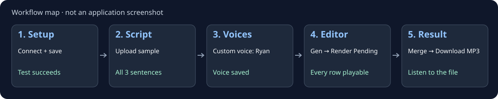

# Side Story

*Formerly Alexandria Audiobook Nya.*

Turn a book into a multi-voice audiobook. Alexandria combines AI script annotation, local Qwen3-TTS, and a browser editor so you can assign characters, listen, fix individual lines, and export the finished book.

**[Install](#installation) · [Make your first audiobook](#quick-start) · [Optional voice tools](#optional-voice-lab--preparer-dependencies) · [Troubleshooting](#troubleshooting) · [Full user guide](https://github.com/on22s/Side-Story/wiki)**

English | [中文](README_CN.md) | [日本語](README_JA.md)

## At a glance

- **Bring your book:** upload TXT, Markdown, or EPUB and generate an editable script with speaker and delivery directions.
- **Build a cast:** use preset voices, clone a reference voice, design a voice, or load a LoRA adapter. Reuse voices and series casts across books.
- **Review before export:** preview chunks, edit text and speakers, regenerate selected lines, and run text-integrity and voice checks.
- **Export your audiobook:** merged MP3, chaptered M4B, individual lines/chapters, or per-speaker tracks for Audacity.
- **Choose your setup:** run TTS locally or connect an external Qwen3-TTS Gradio server. Automated annotation uses an OpenAI-compatible local or remote LLM; a manual copy-and-paste mode is also available.

Start with the five numbered tabs: **Setup → Script → Voices → Editor → Result**. Designer, Dataset, Training, Preparer, Voice Lab, and Reports are there when you need them.

## Installation

### Pinokio (recommended)

1. Install [Pinokio](https://pinokio.computer/).
2. Choose **Download** and paste `https://github.com/on22s/Side-Story`.
3. Click **Install**, then **Start** and **Open Web UI**.
4. Follow [Quick Start](#quick-start) to connect your LLM and make a short test audiobook.

The normal install includes the audiobook app and Qwen3-TTS runtime. TTS weights download on first use; LLM weights are separate. **Install Voice Tools (Optional)** is needed for native Preparer/Voice Lab stages and the bundled local LLM launchers, not for the basic audiobook workflow.

The launcher creates `app/env` with CPython 3.10 on a fresh install and installs platform-specific PyTorch before the remaining dependencies. Existing environments are retained. See [hardware and first-run guidance](#requirements) before starting a large book.

## Quick Start

**First goal: one short English narration, one Ryan preset, one checked MP3.** Use this [original three-sentence sample](docs/samples/first-audiobook.txt) before uploading a whole book. Open the file and use **Download raw file**, or copy its text into a UTF-8 file named `first-audiobook.txt`.

> The rain stopped just before dawn. A small bird landed on the garden gate. By the time the kettle sang, the sky was bright.

The sample is original text supplied with these docs under the repository's MIT license. It contains no dialogue, so you can learn the workflow with just a narrator.

1. **Setup:** connect an already running LLM using [LLM Setup](https://github.com/on22s/Side-Story/wiki/LLM-Setup). Use **Test Connection**, then **Save Configuration**; testing alone does not save. Set **TTS Mode → Local Model (built in)**, **Device → Auto (best available)**, and **TTS Language → English**. Set **Runs on this machine's GPU?** accurately. Save again after edits. Checkpoint: the connection test succeeds and the configuration save is confirmed.
2. **Script:** choose the sample under **Select Book/Novel (Text, Markdown, or EPUB)**; it uploads automatically. Leave the optional narrator field blank. Click **Generate Annotated Script**. Checkpoint: generation finishes, the three sentences are preserved, and the resulting entries are narration. The number of chunks can vary.
3. **Voices:** on the narrator card, choose **Custom voice → Ryan**. Leave character style empty. Wait for **saved**. Checkpoint: Ryan remains selected with no unsaved-change warning.
4. **Editor:** use **Gen** on the first row and listen. If it sounds right, click **Render Pending**. Checkpoint: every sample row has playable audio; no row is failed or unfinished. **Text integrity** checks saved text against source, not spoken audio, so listen for missing or repeated words too.
5. **Editor → Result:** click **Merge All**. Read the source-text confirmation; cancel and fix unexpected differences. In **Result**, play the result and click **Download MP3**. Checkpoint: the downloaded file opens and contains all three sentences, in order. A merge can still create a file after skipping missing/corrupt chunks: check its logs.



*The map shows the sequence and checkpoints; it is not evidence of a completed generation.*

**If a step fails, stop there.** For a connection failure, return to [LLM Setup](https://github.com/on22s/Side-Story/wiki/LLM-Setup). For first-run TTS downloads or errors, check Pinokio's **Terminal** and [Troubleshooting](https://github.com/on22s/Side-Story/wiki/Troubleshooting). The first voice render downloads weights if absent; it may take longer than later renders.

Remote LLMs receive annotation text; external TTS receives synthesis inputs. Use books and voices you have permission to process. **Save Current is not a full backup:** it does not preserve Editor-only chunk edits, audio, or exports. [Back up active work](https://github.com/on22s/Side-Story/wiki/Updates-and-Backups) before switching books.

### After your first MP3

- [Illustrated walkthrough and recovery](https://github.com/on22s/Side-Story/wiki/First-Audiobook)
- [Manual LLM transport and other providers](https://github.com/on22s/Side-Story/wiki/LLM-Setup)
- [More voices, aliases, personas, cloning, and LoRA](https://github.com/on22s/Side-Story/wiki/Voices)
- [Review, checkpoints, and longer books](https://github.com/on22s/Side-Story/wiki/Scripts-and-Review)
- [M4B, chapters, and Audacity export](https://github.com/on22s/Side-Story/wiki/Rendering-and-Export)
- [Designer, Dataset, Training, Preparer, Voice Lab, and Reports](https://github.com/on22s/Side-Story/wiki/Optional-Voice-Tools)

<details>
<summary>Detailed features</summary>

## Where to start

| I want to… | Start here |
|---|---|
| **Make an audiobook** | [Install](#installation), then follow [your first audiobook](#your-first-audiobook). |
| **Pick a model for my graphics card** | [Which model for your card](#which-model-for-your-card), then the [full guide](docs/wiki/Which-Model-For-Your-Card.md). |
| **Understand the research results** | [Results at a glance](#results-at-a-glance), then [RECIPES.md](RECIPES.md) and the [Muse quant comparison](docs/results/muse-quant-baselines.md). |
| **Find a particular run or its raw data** | Search the [results index](RESULTS_INDEX.md); each entry links to the committed artifact. |
| **Browse all documentation** | The [documentation map](docs/README.md) lists user guides, operations notes, results and history. |
| **Contribute** | The [project wiki](https://github.com/on22s/alexandria-audiobook2/wiki), then [Contributing](#contributing) and [GOALS.md](GOALS.md). |

You do not need to read any of the research sections to install or use the app.

## Research and development

It is a research fork of [Alexandria](https://github.com/Finrandojin/alexandria-audiobook).
What makes it different is that **every choice is measured**:

- which model and prompt pick the right speaker, scored against books where
  people have labelled every line;
- how close a generated voice gets to a real human reading;
- whether details like Japanese pitch accent survive synthesis.

The settings that won are the defaults, and every alternative stays selectable
in the Setup tab. For example, the `michel2_full` attribution prompt became the
default on 2026-09-19, once the last model family confirmed it was best. The
numbers, the failures and the recipes are all in this repository.

**Key documents**

- **[GOALS.md](GOALS.md)** — what "good" means for each goal, with the current measurement
- **[RECIPES.md](RECIPES.md)** — the training and serving settings that worked, each with the look-alike setting that failed
- **[RESULTS_INDEX.md](RESULTS_INDEX.md)** — every experiment artifact
- **[Adapters on Hugging Face](https://huggingface.co/Om22s/alexandria-qwen3-attribution)**, and **[HF_MODEL_GUIDE.md](HF_MODEL_GUIDE.md)** for how they are released

### AI-Powered Pipeline
- **Local & Cloud LLM Support** - Connect an OpenAI-compatible API (LM Studio, Ollama, OpenAI, etc.)
- **Three-Pass Script Annotation** - Separate segmentation, speaker attribution, and delivery instructions, with editable prompt presets and surrounding-text context
- **Resumable Generation** - Pause, save snapshots, resume failed runs, and process batches of books
- **Provider Profiles** - Separate local/remote settings, request timeouts and retries, custom provider options, and optional failover
- **LLM Script Review** - Optional review of speaker assignments, narration/dialogue boundaries, and delivery directions, with source-text preservation checks
- **Persona Generation** - LLM analyzes the script to create voice descriptions for each character, then generates reference audio via VoiceDesign and assigns clone voices automatically — one click to go from script to fully-voiced cast
- **Reusable Voices & Series Casts** - Save voices to a library, apply a cast across books, and change character style over a timeline
- **Speaker Aliases** - Map multiple speaker names to the same voice (e.g. "YOUNG ELENA" → "ELENA") so variants share a single voice configuration
- **Chunk Editing** - Review and adjust script chunks before rendering
- **Context Preservation** - Uses speaker roster and surrounding-text context during annotation

### Voice Generation
- **Built-in TTS Engine** - Qwen3-TTS runs locally with no external server required
- **External Server Mode** - Optionally connect to a remote Qwen3-TTS Gradio server
- **Multi-Language Support** - English, Chinese, French, German, Italian, Japanese, Korean, Portuguese, Russian, Spanish, or Auto-detect
- **Custom Voices** - 9 pre-trained voices with instruct-based emotion/tone control
- **Voice Cloning** - Create a clone voice from a clean reference sample and its exact transcript; uploaded references must pass validation
- **Voice Designer** - Create new voices from text descriptions (e.g. "A warm, deep male voice with a calm and steady tone")
- **LoRA Voice Training** - Fine-tune the Base model on custom voice datasets to create persistent voice identities with instruct-following
- **Built-in LoRA Presets** - Preset catalog included; adapter weights download from Hugging Face when requested
- **Dataset Builder** - Interactive tool for creating LoRA training datasets with per-sample text, emotion, and audio preview
- **Batch Processing** - Render multiple chunks with configurable batch sizes
- **Codec Compilation** - Optional `torch.compile` optimization; benefit and warmup depend on hardware
- **Source Fidelity** - Preserves written vocalizations and adds delivery directions separately
- **Natural Pauses** - Configurable silence between speakers (default 500ms) and same-speaker segments (default 250ms)

### Web UI Editor
- **Streamlined Interface** - 5-step core pipeline (Setup, Script, Voices, Editor, Result) plus advanced tools
- **System Health & Run Reports** - GPU/disk status, task diagnostics, and run history
- **Quality Checks** - Text-integrity checks and voice-drift checks before export
- **Chunk Editor** - Edit speaker, text, and instruct for any line
- **Selective Regeneration** - Re-render individual chunks without regenerating everything
- **Batch Processing** - Optimized batch rendering with sub-batching for efficient GPU utilization
- **Live Progress** - Real-time logs and status tracking for all operations
- **Audio Preview** - Play individual chunks or sequence through the entire audiobook
- **Script Library** - Save and load annotated scripts with voice configurations

### Export Options
- **Combined Audiobook** - Single MP3 with all voices and natural pauses
- **Individual Voicelines** - Separate MP3 per line for DAW editing (Audacity, etc.)
- **Audacity Export** - One-click zip with per-speaker WAV tracks, LOF project file, and labels for automatic multi-track import into Audacity
- **M4B Audiobook** - Chaptered M4B (AAC) with title/author/narrator metadata, cover art, and chapter markers
- **Chapter Export** - Export individual chapters with filename templates and readiness checks

</details>

## Requirements

- A local GPU is recommended for practical TTS generation. CPU mode is available but slower. Memory use depends on the model, batch size, and whether an LLM shares the GPU; there is no universal safe batch size.
- Allow several GB per TTS model variant, plus Python/PyTorch environments, optional LLM weights, source books, and generated audio. Downloads and working data can grow substantially.
- Automated script generation needs a reachable OpenAI-compatible LLM endpoint. TTS itself does not require an external server in local mode.

### GPU Compatibility

These are the installer paths, not a guarantee for every GPU or driver:

| Platform | Local TTS path | What to check |
|----------|----------------|---------------|
| NVIDIA on Windows/Linux | PyTorch 2.7 / CUDA 12.8 | A CUDA-compatible GPU and driver; optional attention wheels depend on Python/platform compatibility |
| AMD on Linux | PyTorch 2.10 / ROCm 7.0 | Your GPU and host ROCm/driver compatibility; the installer identifies RX 9070 XT / RDNA4 as its tested target, not all AMD cards |
| AMD on Windows | CPU | This installer does not provide AMD GPU acceleration on Windows |
| macOS (Apple Silicon) | MPS when available, otherwise CPU | `auto` selects MPS if PyTorch reports it available; end-to-end performance and compatibility are not guaranteed |
| macOS (Intel) | CPU fallback | The installer uses an older PyTorch pin; validate your environment with a short sample |
| Other CPU-only setups | CPU | Expect slower generation; start with a short sample |

The exact pins live in [torch.js](torch.js), and runtime selection in [app/device_utils.py](app/device_utils.py). Docker’s supplied Compose configuration targets NVIDIA GPUs; it is not an AMD deployment recipe.

## Other installs and optional tools

### Optional Voice Lab / Preparer dependencies

For audiobook-to-dataset preparation or native Voice Lab profiling, stop the app and choose **Install Voice Tools (Optional)** in Pinokio. This separate installer:

- builds `llama-cpp-python` for CUDA, HIP, Metal, or CPU as appropriate;
- creates an isolated `preparer_env` on every platform, with its own PyTorch constraints;
- fetches the pinned whisper.cpp source and model, verifies them, and builds the selected backend;
- installs speaker diarization only on Linux AMD, whose current PyTorch pin meets pyannote 4’s `torch>=2.8` requirement. Other platform pins do not, so do not add pyannote to `app/env`.

Native builds need CMake and a working C/C++ toolchain, plus the matching CUDA/ROCm SDK for GPU builds. This adds download time and disk use. Configure the relevant model and interpreter paths in the tools before use. Diarization additionally needs a Hugging Face token and acceptance of the [Community-1 model terms](https://huggingface.co/pyannote/speaker-diarization-community-1). The core audiobook pipeline does not need this optional install.

#### Command-line preparation and review

The production command-line tools are included too. Run these commands from the checkout root after **Install Voice Tools (Optional)**. On Windows, replace `preparer_env/bin/python` with `preparer_env\Scripts\python.exe`.

- Prepare a folder of audiobooks with matching EPUB/TXT sources:
  `preparer_env/bin/python alexandria_batch_processor.py --folder /path/to/audio --source-folder /path/to/books --model /path/to/model.gguf`
- Review and approve corrections to an extracted dataset against its source:
  `preparer_env/bin/python alexandria_compare.py --help`
- Check the core app environment: `python env_doctor.py`. Add `--voice-tools` to check the optional environments, or `--json` for machine-readable output.
- Download a standalone legacy Whisper-base Transformers bundle for offline use:
  `preparer_env/bin/python download_model.py`. This downloads Whisper weights to `models/whisper-base`; it does not download a GGUF LLM or replace the current whisper.cpp setup.

On Linux, `bash run_with_restart.sh --audio /path/to/book.wav --source /path/to/book.epub --model /path/to/model.gguf --output /path/to/dataset.zip` adds bounded retries and checkpoint resume while retaining the shared GPU lock. It prefers `preparer_env/bin/python`; set `ALEXANDRIA_PREPARER_PYTHON` to use another prepared interpreter. `MAX_RETRIES` and `BACKOFF_SECONDS` control the retry limit and delay.

For multiple explicitly paired books, `corpus_alignment_prescan.py` validates initial alignment and `corpus_run_report.py` runs preparation and reports verified output receipts. Both accept `--repo`, `--pairs`, and `--output-dir` (see `--help`); new report runs require `--model`, with an optional `--fallback`. The pairs file is a JSON array of `{ "audio": "/path/book.wav", "source": "/path/book.epub", "output_name": "book.zip" }` objects. These launch the Linux restart wrapper, so they need the same optional environment.

The Docker image includes the scripts but does not install native Voice Tools. Use a separately prepared interpreter via `ALEXANDRIA_PREPARER_PYTHON` for preparation; ordinary audiobook generation is unaffected.

#### Local LLM launchers and runtime diagnostics

After **Install Voice Tools (Optional)**, Pinokio's **Start LLM** actions serve the selected GGUF from the checkout root and update the local LLM profile. Model weights are not downloaded automatically. Reset and Update stop this server before changing files.

For an independently installed native `llama-server` on Linux, `start_llama_server.sh` and `ensure_llama_server.sh` retain verified model/adapter identity and lifecycle locking. Set `LLAMA_BIN`, `LLAMA_MODEL`, and optionally `LLAMA_PORT`/`LLAMA_LOG` explicitly for your installation; these helpers do not install the native binary or models.

Additional production-support CLIs, using the app environment:

- `app/env/bin/python app/analyze_generation_attempts.py --json` summarizes saved generation quality manifests.
- `app/env/bin/python app/repair_source_llm.py --help` explains source-repair proposals. The default is report-only (it still contacts your configured LLM); writing repaired output requires `--apply`.
- `app/env/bin/python app/tts_vram_benchmark.py --help` explains custom/clone voice GPU batch and codec tuning. Running a sweep loads real models and consumes GPU time.
- `app/env/bin/python tools/backfill_adapter_digests.py --root /path/to/adapters` audits missing provenance digests. It is dry-run unless `--apply` is specified; it never replaces mismatched existing digests or claims historical training verification.

On Windows use `app\env\Scripts\python.exe`; in Docker use `python` for these four Python CLIs. The standalone native server shell launchers are intended for a prepared Linux checkout, not the base Docker image.

### Google Colab

The included notebook installs and launches the app in a Colab runtime. GPU availability and session limits depend on Colab:

[](https://colab.research.google.com/github/on22s/Side-Story/blob/main/alexandria_colab.ipynb)

The notebook uses Google Drive persistence and Colab's built-in inline port forwarding; no ngrok account is needed. See the notebook for full instructions.

### Docker (NVIDIA GPU)

For integration into automated pipelines or server deployments:

```bash
git clone https://github.com/on22s/Side-Story.git
cd Side-Story
docker compose up --build
```

Requires [Docker](https://docs.docker.com/get-docker/) with the [NVIDIA Container Toolkit](https://docs.nvidia.com/datacenter/cloud-native/container-toolkit/install-guide.html). The web UI is available at `http://localhost:4200`. TTS models download on first use and are cached in a Docker volume. User data persists via bind mounts to the project directory. The default image installs the audiobook runtime; it does not build the optional native Voice Tools or create `preparer_env`.

#### Docker data and upgrades

- Back up `data/` before upgrading. Keep the same project directory and existing Docker model-cache volume.
- New mutable state uses `ALEXANDRIA_DATA_DIR=/alexandria/runtime`, mounted from `./data/runtime`.
- Existing host folders (`data/uploads`, `data/scripts`, `data/designed_voices`, `data/clone_voices`, `data/lora_models`, `data/lora_datasets`, `data/dataset_builder`, and `data/output`) remain mounted at the corresponding runtime subdirectories. No host-data move is needed.
- Legacy container paths such as `/alexandria/scripts`, `/alexandria/voicelines`, and `/alexandria/app/uploads` are symlinks to those locations.
- WebUI settings use `ALEXANDRIA_CONFIG_PATH=/alexandria/config/config.json`, backed by `./data/config`. Keep that mount when customizing Compose.
- If using `docker run` instead, persist both the runtime directory and the config directory yourself.

#### Network security

Compose publishes only `127.0.0.1:4200`; the container binds `0.0.0.0` for Docker forwarding. Authentication is off by default. Before exposing the host port, using a tunnel, or adding a reverse proxy, set `ALEXANDRIA_AUTH_PASSWORD` in the container environment (and optionally `ALEXANDRIA_AUTH_USERNAME`, default `alexandria`). Use HTTPS for access beyond a trusted local network.

For a domain, set `ALEXANDRIA_ALLOWED_HOSTS` to the hostname. For browser API access from a separate web origin, include that exact origin in `CORS_ORIGINS` (comma-separated). This list feeds both CORS and the request-origin gate; `ALEXANDRIA_ALLOWED_ORIGINS` extends only the gate and does not by itself enable cross-origin browser API access. Host/origin checks do not replace authentication. Never bake credentials into the image or commit them to Compose.

## First launch

- **Configure the LLM first** for automatic annotation. Check its server is running, its model name matches Setup, and its URL is reachable from the app. Inside Docker, `localhost` refers to the container, not a server on your host.
- **Expect model downloads.** Qwen3-TTS variants download from Hugging Face when first needed and are cached locally. Watch the terminal for download or model-loading progress before assuming the app has stalled.
- **Start small.** Try a short passage and a small batch. The first generation can take longer while models load and GPU kernels warm up. Increase batch size only after checking memory use.
- **Protect your source and voices.** Remote LLM providers receive the text you submit for annotation/review. External TTS sends generation inputs, including reference audio/transcripts for clone voices, to the configured server. Use books and reference voices you have permission to process.

## Updates and your data

Save your script and back up your work before **Update**. The launcher stops active writers, pulls code, and reruns the core installer; it does not guarantee recovery of an interrupted job. If optional dependencies change, stop the app and rerun **Install Voice Tools (Optional)**.

For a normal Pinokio/local checkout, keep `app/config.json`, active-project JSON files, `app/uploads/`, `voicelines/`, saved scripts, and your voice/dataset/model libraries. These generated files are not backed up by Git. `ALEXANDRIA_DATA_DIR` can relocate mutable data; `ALEXANDRIA_CONFIG_PATH` overrides the settings file independently. Back up the actual configured locations.

**Reset is destructive to the active project.** It removes the default active script, voice assignments, chunk/state files, generated voicelines, merged MP3, and `app/config.json`. It retains reusable libraries. The current reset script names default checkout paths, so do not assume it clears a custom data/config directory. See [reset.js](reset.js) and [Docker data and upgrades](#docker-data-and-upgrades).

<details>
<summary>Tab-by-tab interface guide</summary>

## Web Interface

### Setup Tab
Configure connections to your LLM and TTS engine.

**TTS Settings:**
- **Mode** - `local` (built-in engine) or `external` (connect to Gradio server)
- **Device** - Start with `auto`; the UI also exposes CUDA device choices and CPU. The backend accepts MPS when available
- **Language** - TTS synthesis language: English (default), Chinese, French, German, Italian, Japanese, Korean, Portuguese, Russian, Spanish, or Auto (let the model detect)
- **Parallel Workers** - Outer local batch size, or concurrent external requests per server; higher values use more resources. **Auto-configure** sets 4 on 12–20 GB cards (measured on an RX 9070 XT: about 23% faster than 2, same Whisper recall, passed a listening check)
- **Batch Seed** - Seed for local batched Custom/Clone/LoRA generation; it does not override every voice path
- **Compile Codec** - Currently has no effect: the pinned TTS library (qwen-tts 0.1.1) decodes outside the compiled code, so render speed is unchanged. Leave it off
- **Sub-batching** - Split batches by text length to reduce wasted GPU compute on padding (enabled by default)
- **Max Items/Batch** - Hard cap on local sub-batches; 0 uses the VRAM estimate. Memory/manual limits still apply with length-based sub-batching disabled
- **Min Sub-batch Size** - Minimum chunks per sub-batch before allowing a split (default: 4)
- **Length Ratio** - Maximum longest/shortest text length ratio before forcing a sub-batch split (default: 5)
- **Speaker Change Pause** - Silence in milliseconds between different speakers during merge (default: 500)
- **Same Speaker Pause** - Silence in milliseconds when the same speaker continues during merge (default: 250)

**Prompt Settings (Advanced):**
- **Generation Settings** - Chunk size and max tokens for LLM responses
- **LLM Sampling Parameters** - Temperature, Top P, Top K, Min P, and Presence Penalty
- **Banned Tokens** - Comma-separated list of tokens to ban from LLM output; this is not a universal reasoning-mode switch
- **Step 1: model output format** - *Full text* (default) or *Compact labels* (experimental). Compact labels sends numbered sentences and asks only for a label per sentence; any chunk whose compact answer is unusable falls back to full text. It only affects chunks the quote marks don't settle
- **Step 3: extra text around each request** - Read-only surrounding text added to delivery-note requests, in characters per side (0–1,000,000; default 0). Step 3 no longer repeats lines that are already in the same request. No quality gain was measured at 4,000 characters, so leave it at 0 unless you are testing; values above 20,000 need a known model context
- **Prompt Customization** - Separate generation-pass presets plus review/persona prompts. See [Prompt Customization](#prompt-customization); save the form to persist edits

### Script Tab
Upload a text file (.txt, .md, or .epub) and generate the annotated script. EPUB files are automatically converted to plain text on upload. The LLM converts your book into a structured JSON format with:
- Speaker identification (NARRATOR vs character names)
- Source text preserved through segmentation, including written vocalizations
- Style directions for TTS delivery

**Review Script** checks speaker assignments, narration/dialogue boundaries, and delivery directions while preserving source text. Consecutive-narrator merging is optional and off by default. Review the result rather than assuming every annotation was corrected.

Setup's **Attribution prompt** chooses how speakers are asked for. `michel2_full` is the default; `michel2_spoken` asks only about the spoken lines and, on Qwen3-14B without an adapter, scored 6.5 points higher with about 3× less step-2 time. Other models are not measured yet, and an attribution adapter should keep the prompt it was trained on. An opt-in **labels-only review** (`prompts.review_labels_only`) returns only speakers and delivery notes and never retypes the text. Every model reply is logged in `logs/llm_responses.log`, with the exact request beside it in `logs/llm_responses.requests.log`. Hover the ⓘ beside any setting for what it does. Details: [Scripts and review](https://github.com/on22s/Side-Story/wiki/Scripts-and-Review), [Troubleshooting](https://github.com/on22s/Side-Story/wiki/Troubleshooting).

**Speaker-label suggestions** compares a stopped-run snapshot with a saved provisional reference, then lets you inspect bounded model judgments and explicitly apply one alias at a time. See [Speaker-label review](docs/speaker-label-review.md).

Review prompts can be edited in Setup or through their file defaults in `review_prompts.txt`; the runtime’s text-preservation validation still applies. If the GPU is already full when review starts, review stops at once with a message instead of retrying; free the memory (for example, unload the model holding it) and start review again.

**Preserve source words** (a checkbox before generating) keeps every source word, in order, through annotation and review, and refuses to publish a script or render a chunk whose words changed. Speech preparation may still expand numbers and symbols later. It is off by default; see [Literal source policy](docs/literal_source_policy.md).

### Voices Tab
After script generation, voices are automatically loaded from the annotated script. For each speaker:

**Persona Generation:**
Click **Generate Personas** to automatically assign voices to all characters. The LLM analyzes dialogue in the script and produces a voice description and sample text for each speaker. These are fed to the VoiceDesign model to generate reference audio, which is saved and assigned as a clone voice. Review the assigned references and voice settings before rendering.

- **Standard mode** — Processes selected speakers sequentially
- **Advanced mode** — Controls discovery batches of script entries (default 40 entries), with dialogue samples used to infer voice characteristics. Use **Apply to** to choose unassigned speakers or regenerate all speakers; check the scope before starting

**Speaker Aliases:**
Each voice card has an "Alias of" dropdown. Setting a speaker as an alias of another speaker means it will use the target's voice configuration during audio generation. Useful for:
- Character name variants (e.g., "DR. SMITH" → "SMITH")
- Age variants (e.g., "YOUNG ELENA" → "ELENA")
- Reducing the number of voices to configure

Aliases resolve transitively (A → B → C uses C's config) with cycle detection.

**Custom Voice Mode:**
- Select from 9 pre-trained voices: Aiden, Dylan, Eric, Ono_anna, Ryan, Serena, Sohee, Uncle_fu, Vivian
- Set a character style that combines persistent traits with each line’s delivery direction (e.g., "Heavy Scottish accent", "Refined aristocratic tone")
- Optionally set a seed for reproducible output

**Clone Voice Mode:**
- Select a designed voice or enter a custom reference audio path
- Provide the exact transcript of the reference
- Note: Instruct directions are ignored for cloned voices

**LoRA Voice Mode:**
- Select a trained LoRA adapter from the Training tab
- Set a character style to combine with each line’s delivery direction
- Combines voice identity from training with instruct-following from the Base model

**Voice Design Mode:**
- Set a base voice description (e.g., "Young strong soldier")
- Each line's instruct is appended as delivery/emotion direction
- Generates voice on-the-fly using the VoiceDesign model — ideal for minor characters

### Designer Tab
Create new voices from text descriptions without needing reference audio.

- **Describe a voice** in natural language (e.g., "A warm elderly woman with a gentle, raspy voice and a slight Southern drawl")
- **Preview** the voice with sample text before saving
- **Save to library** for use as clone voice references in the Voices tab
- Uses the Qwen3-TTS VoiceDesign model to synthesize voice characteristics from descriptions

### Training Tab
Train LoRA adapters on the Base model to create custom voice identities. The built-in preset catalog appears alongside your trained adapters; its weights download separately from Hugging Face.

**Dataset:**
- **Upload ZIP** — WAV files (24kHz mono) + `metadata.jsonl` with `audio_filepath` and `text` fields
- **Build New Dataset** — Opens the Dataset tab to create training samples
- **Dataset Builder** — Interactive tool in its own tab (see below) for building datasets sample-by-sample with preview

**Training Configuration:**
Set the adapter name, epochs, learning rate, rank/alpha, language, batch size, and gradient accumulation for your dataset and hardware. Use the UI’s current defaults as a starting point and test an adapter on held-out lines before a whole-book render. Training quality and delivery control depend on the data and settings; larger rank or more epochs are not automatic improvements.

### Dataset Tab
Build LoRA training datasets interactively, one sample at a time.

- **Create a project** with a voice description and optional global seed
- **Define samples** — Set text and emotion/style per row
- **Preview audio** — Generate and listen to individual samples or batch-generate all at once
- **Cancel batch** — Stop a running batch generation without losing completed samples
- **Save as dataset** — Export the project as a training-ready dataset that appears in the Training tab
- Designed voices and Voice Designer descriptions drive the audio generation via Qwen3-TTS VoiceDesign model

### Editor Tab
Fine-tune your audiobook before export:
- **View all chunks** in a table with status indicators
- **Edit inline** - Click to modify speaker, text, or instruct
- **Generate single** - Regenerate just one chunk after editing
- **Batch render** - Process all pending chunks (see Render Modes below)
- **Play sequence** - Preview audio playback in order
- **Merge all** - Combine chunks into final audiobook

### Rendering

**Render Pending** selects the appropriate path automatically: local TTS uses batched generation, while external TTS uses parallel requests. The main UI does not offer separate Standard and Batch (Fast) buttons. Custom, Clone, and LoRA support local batches; Voice Design and Ensemble render sequentially. Tune **Parallel Workers** and **Max Items/Batch** to available memory, and preview a short run before increasing them.

### Result Tab
Download your completed audiobook as MP3, export as **M4B** with chapter markers for audiobook players, or click **Export to Audacity** for per-speaker WAV tracks.

- **Download MP3** - Standard merged audiobook
- **Export M4B** - AAC audiobook with chapter markers. By default, chapters are auto-detected from headings in the script (e.g. "Chapter 1", "Prologue"). Toggle **Per-chunk chapters** for fine-grained navigation where every line becomes a chapter.
- **Export to Audacity** - Zip with per-speaker WAV tracks. Unzip and open `project.lof` in Audacity to load all tracks, then import `labels.txt` via File > Import > Labels for chunk annotations.

> **Note:** Some Linux audiobook players (e.g. Cozy) have limited M4B support and may not detect the file. The M4B output has been tested with VLC, Haruna, and Audiobookshelf.

</details>

## Performance and GPU tuning

Start with small batches and measure on your own hardware. Local batch rendering improves throughput; **Auto-configure** picks a batch size for your card. **Compile Codec** currently has no effect, so leave it off. Reduce **Parallel Workers** or **Max Items/Batch** after an out-of-memory error. Leave headroom if the LLM and TTS share a GPU.

On AMD/Linux, check the actual GPU/ROCm combination before changing packages. Do not copy device-specific power-profile commands or replace the installer’s PyTorch pins blindly. For a controlled local measurement, see `app/tts_vram_benchmark.py --help`; a sweep loads real models and consumes GPU time. No throughput figure here is a promise for your system.

<details>
<summary>Script format, output files, and API examples</summary>

- Four-book fixture: **97.3% / 97.5% / 94.5% / 92.9%** per book. Two books are outside
  the 5% band the goal asks for.
- All 28 PDNC novels: the best local model, Qwen3.8-27B UD-Q3_K_XL, is within 5% on
  **20 of 28** books. The misses are being re-measured at 40 windows per book.

The generated script is a JSON array with `speaker`, `text`, and `instruct` fields:

```json
[
  {"speaker": "NARRATOR", "text": "The door creaked open slowly.", "instruct": "Calm, even narration."},
  {"speaker": "ELENA", "text": "Ah! Who's there?", "instruct": "Startled and fearful, sharp whispered question, voice cracking with panic."},
  {"speaker": "MARCUS", "text": "Haha... did you miss me?", "instruct": "Menacing confidence, low smug drawl with a dark chuckle, savoring the moment."}
]
```

- **`instruct`** — Short TTS voice direction describing tone and delivery; the default delivery pass asks for 1–2 sentences of roughly 8–15 words. Example: "Devastated by grief, Sniffing between words and pausing to collect herself, end with a wracking sob."

### Source text and delivery

The current three-pass pipeline aims to preserve source words during segmentation and adds short voice directions separately. Written vocalizations remain source text. Review the generated script and text-integrity report before rendering or merging; annotation is not a guarantee of perfect fidelity.

## Output Files

`ALEXANDRIA_DATA_DIR` can move mutable application state to a separate directory. Docker sets it to `/alexandria/runtime`; the bind mounts above preserve existing host data. `ALEXANDRIA_CONFIG_PATH` independently controls the settings file.

**Final Audiobook:**
- `cloned_audiobook.mp3` - Combined audiobook with natural pauses

**Individual Voicelines (for DAW editing):**
Files live under `voicelines/` and use a unique chunk identifier plus speaker name, such as `voiceline_<uid>_narrator.mp3`. WAV is used if MP3 encoding fails. Use the Editor or chunk metadata for timeline order; filenames are not sequential timeline numbers.

**Audacity Export (per-speaker tracks):**
```
audacity_export.zip
├── project.lof       # Open this in Audacity to import all tracks
├── labels.txt        # Import via File > Import > Labels for chunk annotations
├── narrator.wav      # Full-length track with only NARRATOR audio
├── elena.wav         # Full-length track with only ELENA audio
├── marcus.wav        # Full-length track with only MARCUS audio
└── ...
```

Each WAV track is padded to the same total duration with silence where other speakers are talking. Playing the tracks together reconstructs the aligned audiobook timeline.

**M4B Audiobook (chaptered):**
- `audiobook.m4b` - AAC audiobook with embedded chapter markers
- Chapters auto-detected from script headings, or per-chunk when toggled
- Use a player that supports AAC M4B files and embedded chapter markers

## API Reference

Use the base URL shown by your running launcher. Pinokio selects an available port; direct `python app.py` defaults to `http://127.0.0.1:4200` unless `ALEXANDRIA_PORT` is set.

- Interactive API schema: `<BASE>/docs`
- OpenAPI JSON: `<BASE>/openapi.json`
- If `ALEXANDRIA_AUTH_PASSWORD` is set, requests require HTTP Basic authentication. The default username is `alexandria`; `ALEXANDRIA_AUTH_USERNAME` can override it.
- Browser clients must use an allowed origin. Same-origin requests are simplest; review the network-security settings before connecting another web app.
- Check HTTP response codes before continuing. A successful start response means work was accepted, not completed.

### Configuration and scripts

- `GET /api/config`: current configuration, with API keys redacted.
- `GET /api/default_prompts`: default prompt texts for the generation passes, review, and personas.
- `POST /api/config`: save configuration. Include `llm`, `tts`, and the active `llm_local` or `llm_remote` profile matching `llm_mode`; consult the schema for fields.
- `POST /api/upload`: multipart field `file`; accepts `.txt`, `.md`, and `.epub` and selects the uploaded source by default.
- `POST /api/generate_script`: start or resume generation for the selected source. Optional JSON includes `strip_front_matter`, `first_person_narrator`, and `start_over`.
- `GET /api/annotated_script`: retrieve the current script.
- `POST /api/review_script`: start script review.
- `GET /api/scripts`, `POST /api/scripts/save`, `POST /api/scripts/load`: list, save, or load scripts; save/load take `{"name":"my-novel"}`.

### Voices and rendering

- `GET /api/voices`: list script speakers and their current voice configuration.
- `POST /api/save_voice_config`: update speaker-keyed settings, such as `{"NARRATOR":{"type":"custom","voice":"Ryan","character_style":"calm"}}`.
- `POST /api/generate_personas`: generate personas and voice references; track task `persona`.
- `GET /api/chunks`: retrieve the editor’s ordered chunk array, including status and audio paths.
- `POST /api/chunks/{index}`: update a chunk; `POST /api/chunks/{index}/generate`: render it.
- `POST /api/generate_batch` or `POST /api/generate_batch_fast`: render selected zero-based array positions, for example `{"indices":[0,1,2]}`. These are positions, not chunk IDs.
- `GET /api/editor/integrity`: compare editor text with the source before merging.
- `POST /api/merge`: start MP3 merging. A report that is not verified requires confirmation; missing confirmation or a stale supplied snapshot returns HTTP 409. Review the report before explicitly confirming its `snapshot` as `integrity_confirmation`.
- `GET /api/audiobook`: download the merged MP3 after the merge finishes.
- `POST /api/export_audacity`: start per-speaker export; `GET /api/export_audacity`: download its ZIP.
- `POST /api/merge_m4b`: start chaptered M4B export with JSON options; `GET /api/audiobook_m4b`: download it.

### Task status and workflow

`GET /api/status` lists registered task names. Poll `GET /api/status/{task_name}` for `running`, logs, and any task-specific result.

| Operation | Task name |
| --- | --- |
| Script generation | `script` |
| Script review | `review` |
| Persona generation | `persona` |
| Chunk rendering and MP3 merge | `audio` |
| Audacity / M4B export | `audacity_export` / `m4b_export` |
| LoRA training | `lora_training` |

Start endpoints generally return `{"status":"started"}` rather than a task ID. There is no universal `completed`/`error` status field: `running: false` only means the task stopped. Inspect its logs and task-specific result before using outputs.

For an end-to-end client: upload → generate → wait and check generation → optionally review and wait → configure voices → render → wait and verify all intended chunks are `done` → review integrity → merge → wait and check merge logs → download. Audacity exports additionally expose `result.status` (`done`, `failed`, or `cancelled`).

See `/docs` for the current Voice Designer, Dataset Builder, training, cancellation, and advanced request schemas.

</details>

## Choosing an LLM

Use an instruction-following model that returns the requested structured output. Test a short passage before processing a whole book; quality, context limits, and memory needs vary. LM Studio, Ollama’s OpenAI-compatible endpoint, and compatible hosted APIs can be configured in Setup.

If the model emits reasoning instead of the requested answer, use that provider/model’s supported non-thinking settings. A banned-token setting is not a universal way to disable reasoning. Manual mode lets you copy each pending request to a model and paste its answer back; it is more work for long books.

## Troubleshooting

### Script generation fails
- Check LLM server is running and accessible
- Verify model name matches what's loaded
- Try a different model - some struggle with JSON output

### Model download fails or is very slow
- TTS models (~3.5 GB each) are downloaded from Hugging Face on first use
- If downloads are slow or fail due to network restrictions (common in mainland China), set a Hugging Face mirror before launching:
  - Set the environment variable `HF_ENDPOINT=https://hf-mirror.com` before starting the app
  - Or in Pinokio, add it to start.js `env` field: `env: { HF_ENDPOINT: "https://hf-mirror.com" }`
- If you hit rate limits, create a free [Hugging Face account](https://huggingface.co/join) and set `HF_TOKEN` to your access token
- Downloads resume automatically if interrupted — just restart the app

### TTS generation fails
- Check the Pinokio terminal for model loading errors
- Check available memory and lower the batch limits if model loading or rendering runs out of memory
- For external mode, ensure the Gradio TTS server is running at the configured URL
- Check voice_config.json has valid settings for all speakers
- For clone voices, verify reference audio exists and transcript is accurate

### Slow batch generation
- Run **Auto-configure** in Setup, or increase **Parallel Workers** (batch size) if VRAM allows
- **Compile Codec** currently has no effect; turning it on does not speed up rendering
- **Render Pending** selects local batch generation automatically
- On AMD, check the full error and the installed ROCm/PyTorch build; not every MIOpen warning has the same cause

### Out of memory errors
- Reduce **Parallel Workers** (batch size)
- Close other GPU-intensive applications
- Try `device: cpu` as a fallback (much slower)

### Broken or tiny MP3 files (428 bytes)
If ffmpeg lacks the MP3 encoder (libmp3lame), individual chunk export can fall back to WAV. Merged MP3 still requires working MP3 encoding:
- Install ffmpeg with MP3 support: `conda install -c conda-forge ffmpeg`
- Or remove conda's ffmpeg to use your system one: `conda remove ffmpeg`
- Verify with: `ffmpeg -encoders 2>/dev/null | grep mp3`

### Audio quality issues
- Use a clean reference clip and an accurate transcript; imported clips must meet the app’s 3–30 second duration and audio-quality checks, with rights confirmation
- Avoid background noise in reference samples
- Try different seeds for custom voices

### Mojibake characters in output
- Known source-encoding problems may be repaired in memory without changing the source file; unresolved problems are reported
- If problems persist, ensure your input text is UTF-8 encoded

## Prompt Customization

**Setup → Prompt Settings (Advanced)** has separate presets for segmentation (Step 1), attribution (Step 2), and delivery notes (Step 3), plus review and persona prompts. Use **What the model will see** to inspect attribution requests.

**Save Configuration** or **Save preset and Setup** persists edits. **Reset to Defaults** replaces the form contents; save afterward to keep that change.

Default prompt sources:
- [app/default_prompts_segment.txt](app/default_prompts_segment.txt): segmentation
- [app/default_prompts_instruct.txt](app/default_prompts_instruct.txt): delivery notes
- [app/attribution_prompt_variants.py](app/attribution_prompt_variants.py): attribution variants, with [app/default_prompts_attribute.txt](app/default_prompts_attribute.txt) for the default-shaped variant
- [review_prompts.txt](review_prompts.txt) and [persona_prompts.txt](persona_prompts.txt): review and persona defaults

Root `default_prompts.txt` belongs to the legacy single-pass generator; editing it alone does not customize the current three-pass workflow. For non-English books, review the prompts against that language’s dialogue conventions and set TTS Language accordingly.

<details>
<summary>Project structure</summary>

## Project Structure

```
Alexandria/
├── app/
│   ├── app.py                 # FastAPI server and startup
│   ├── routers/               # API route modules
│   ├── core.py                # Shared config, task, and runtime helpers
│   ├── tts.py                 # TTS engine (local + external backends)
│   ├── train_lora.py          # LoRA training subprocess script
│   ├── generate_script.py     # Legacy single-pass annotation
│   ├── generate_personas.py   # LLM persona generation + VoiceDesign voice assignment
│   ├── review_script.py       # LLM script review (second pass)
│   ├── utils.py               # Shared utilities (atomic JSON writes)
│   ├── default_prompts.py     # Generation-pass prompt loaders
│   ├── review_prompts.py      # Review prompt loader (reads review_prompts.txt)
│   ├── project.py             # Chunk management & batch generation
│   ├── parse_voices.py        # Voice extraction
│   ├── config.json            # Runtime configuration (gitignored)
│   ├── static/index.html      # Web UI
│   └── requirements.txt       # Python dependencies
├── builtin_lora/              # Preset catalog and downloaded LoRA adapters
├── dataset_builder/           # Dataset builder project workspace (gitignored)
├── designed_voices/           # Saved Voice Designer outputs (gitignored)
├── lora_datasets/             # Uploaded/generated training datasets (gitignored)
├── lora_models/               # Trained LoRA adapters (gitignored)
├── default_prompts.txt        # LLM prompts for script generation
├── review_prompts.txt         # LLM prompts for script review
├── install.js                 # Lean Pinokio runtime installer
├── install-voice-tools.js      # Optional native Voice Lab / Preparer installer
├── tools/voice_lab/            # Voice processing helpers
├── data/                      # Docker bind mounts (gitignored)
├── start.js                   # Pinokio launcher
├── reset.js                   # Reset script
├── pinokio.js                 # Pinokio UI config
├── pinokio.json               # Pinokio metadata
└── README.md
```

</details>

## Acknowledgements

Side Story builds on work, ideas, bug reports, and testing shared by many people. Thank you to the original Alexandria community and to everyone helping improve the forks.

### Application, contributions, and testing

- [Finrandojin](https://github.com/Finrandojin/alexandria-audiobook): the original Alexandria Audiobook application and the downloadable [Alexandria voice presets](https://huggingface.co/Finrandojin/Alexandria).
- [Ayush Naphade](https://github.com/aayushnaphade): persona generation, speaker alias resolution, and contextual script review ([upstream PR #42](https://github.com/Finrandojin/alexandria-audiobook/pull/42)). His related project is [Lily](https://lily.rayoneai.in/).
- [Michii / on22s](https://github.com/on22s): the [Alexandria Audiobook2](https://github.com/on22s/alexandria-audiobook2) improvements carried into Side Story, including the upstream System Health Dashboard, cross-platform subprocess runner, and Voice Training Dataset Preparer ([#45](https://github.com/Finrandojin/alexandria-audiobook/pull/45), [#46](https://github.com/Finrandojin/alexandria-audiobook/pull/46), [#47](https://github.com/Finrandojin/alexandria-audiobook/pull/47)).
- [REFLEXGAMING007](https://github.com/REFLEXGAMING007): detailed feature proposals, reproduction cases, and repeated testing that shaped the forks' manual LLM workflow, snapshots, incremental personas, editable prompts, and character-state voices ([manual generation](https://github.com/on22s/alexandria-audiobook2/issues/593), [snapshots](https://github.com/on22s/alexandria-audiobook2/issues/600), [incremental updates](https://github.com/on22s/alexandria-audiobook2/issues/602), [prompt editing](https://github.com/on22s/alexandria-audiobook2/issues/634), [state personas](https://github.com/on22s/alexandria-audiobook2/issues/866)).

- [Alchemist-Production](https://github.com/Alchemist-Production): the original Web UI, Audio Editor, and chunk-management work integrated into upstream Alexandria ([integration](https://github.com/Finrandojin/alexandria-audiobook/commit/1667edc237418fbf9e819bfb4294b14209da9c27), [editor](https://github.com/Finrandojin/alexandria-audiobook/commit/717f89161b36ced57c97cea5b729be95b3cba39e)).
- [PierrunoYT](https://github.com/PierrunoYT): the original HTML-escaping security work incorporated by on22s in [upstream PR #39](https://github.com/Finrandojin/alexandria-audiobook/pull/39).
- [Robertoge65](https://github.com/Robertoge65): the external-TTS missing-import fix ([upstream PR #19](https://github.com/Finrandojin/alexandria-audiobook/pull/19)); [kishore-1404](https://github.com/kishore-1404) for the CUDA VRAM-property correction ([upstream PR #35](https://github.com/Finrandojin/alexandria-audiobook/pull/35)).
- [MNeMoNiCuZ](https://github.com/MNeMoNiCuZ): the Docker persona-prompt packaging fix, incorporated through upstream's later Docker update ([original contribution and credit](https://github.com/Finrandojin/alexandria-audiobook/pull/56#issuecomment-5044676266)).

<details>
<summary>Community reports, ideas, and testing behind inherited fixes</summary>

- [ElBiggus](https://github.com/ElBiggus): early Windows/audio feedback and [download](https://github.com/Finrandojin/alexandria-audiobook/pull/5#issuecomment-3870041305) and [CPU-loading](https://github.com/Finrandojin/alexandria-audiobook/issues/4) reports.
- [1BadAshB](https://github.com/1BadAshB): batch-rendering and cancellation testing, and the [stale clone-prompt cache diagnosis](https://github.com/Finrandojin/alexandria-audiobook/issues/17#issuecomment-3940188658) and fix verification.
- [generallogin](https://github.com/generallogin): [model-cache loading](https://github.com/Finrandojin/alexandria-audiobook/issues/22) and [NVIDIA slowdown](https://github.com/Finrandojin/alexandria-audiobook/issues/23) reports and testing.
- [ryuhda](https://github.com/ryuhda): Korean LoRA testing that helped identify and validate the [training/inference prefill fix](https://github.com/Finrandojin/alexandria-audiobook/issues/29#issuecomment-4315574687).
- [sdbrown67](https://github.com/sdbrown67): the [malformed LLM-output report](https://github.com/Finrandojin/alexandria-audiobook/issues/20#issuecomment-3985423529) behind safer entry filtering.
- [WirelessRoth](https://github.com/WirelessRoth): [German-language and prompt feedback](https://github.com/Finrandojin/alexandria-audiobook/issues/13) that helped improve language controls and editable review prompts.
- [damajor](https://github.com/damajor): [Docker startup, configuration, and VRAM-cleanup reports](https://github.com/Finrandojin/alexandria-audiobook/issues/62#issuecomment-5044680044).
- [futuregadets](https://github.com/futuregadets): [Drive-first storage](https://github.com/Finrandojin/alexandria-audiobook/issues/59) and [ngrok-free Colab](https://github.com/Finrandojin/alexandria-audiobook/issues/60) suggestions adopted upstream.
- [Tortoise17](https://github.com/Tortoise17): the [external voice-clone language report](https://github.com/Finrandojin/alexandria-audiobook/issues/69#issuecomment-5062433885).
- [starpause](https://github.com/starpause): the [image-based EPUB chapter-heading discussion](https://github.com/Finrandojin/alexandria-audiobook/issues/80#issuecomment-5309266456) that prompted TOC-based heading recovery ([AA2 implementation](https://github.com/on22s/alexandria-audiobook2/pull/314)).

</details>

### Forks and ideas carried into the app

- [cjdell](https://github.com/cjdell/alexandria-audiobook): the AMD APU precision fix that informed Side Story's fp32 model-loading path ([port](https://github.com/on22s/alexandria-audiobook2/pull/573)).
- [XinchaoGou](https://github.com/XinchaoGou/alexandria-audiobook): OpenAI reasoning-model request handling and environment-referenced API keys, plus ideas for reasoning controls, clone-reference validation, external TTS server pools, and rolling story context ([ports](https://github.com/on22s/alexandria-audiobook2/pull/574), [reasoning controls](https://github.com/on22s/alexandria-audiobook2/pull/530), [reference validation](https://github.com/on22s/alexandria-audiobook2/pull/531), [server pools](https://github.com/on22s/alexandria-audiobook2/pull/532)).
- [Darkkingwill](https://github.com/Darkkingwill/alexandria-audiobook): MP3 bitrate findings and ideas for cancellable merging, export progress, model selection, and remembered tabs, independently rebuilt in AA2 and carried into Side Story ([bitrate](https://github.com/on22s/alexandria-audiobook2/pull/533), [interface improvements](https://github.com/on22s/alexandria-audiobook2/pull/534)).
- [shangyuok](https://github.com/shangyuok/alexandria-audiobook-gg): the idea of configurable TTS generation-token limits, implemented together with matching memory estimates ([implementation](https://github.com/on22s/alexandria-audiobook2/pull/60)).
- [dudarenok-maker / Castwright](https://github.com/dudarenok-maker/Castwright): ideas for remembering a cast across books and checking rendered voice consistency, implemented independently in Alexandria ([series memory](https://github.com/on22s/alexandria-audiobook2/pull/524), [voice checks](https://github.com/on22s/alexandria-audiobook2/pull/525)).
- [Gaspard Michel, Elena V. Epure, Romain Hennequin, and Christophe Cerisara](https://aclanthology.org/2025.naacl-short.62/): the quotation-attribution research behind the `michel` prompt family, adapted into Alexandria's own prompts and surrounding-context handling ([implementation](app/attribution_prompt_variants.py)).

<details>
<summary>Research influences and shared resources</summary>

Side Story also benefits from the research behind AA2. These credits include experiments and evaluation resources; they do not mean every experiment, dataset, or model is included in the Side Story runtime.

- [Xiao Zhang / buddies](https://github.com/buddies/alexandria-audiobook): per-line instruction vocabulary and experiments separating stable voice identity from delivery instructions. The lexicon was ported into AA2's research tools; the resulting comparisons informed the voice-identity work ([audit](https://github.com/on22s/alexandria-audiobook2/pull/601), [voice changes](https://github.com/on22s/alexandria-audiobook2/pull/603)).
- [p0n1](https://github.com/p0n1/epub_to_audiobook): punctuation priorities adapted for AA2's quotation-aware chunking experiment.
- [zeropointnine](https://github.com/zeropointnine/tts-audiobook-tool): transcribe-back validation and truncation-detection ideas explored in AA2.
- [Drew Thomasson / VoxNovel](https://github.com/DrewThomasson/VoxNovel): the BookNLP baseline that prompted attribution comparisons; [David Bamman and the BookNLP contributors](https://github.com/booknlp/booknlp) for the underlying literary NLP work.
- [nazdridoy](https://github.com/nazdridoy/kokoro-tts): weighted voice-blending ideas explored in AA2; [WhiskeyCoder](https://github.com/WhiskeyCoder/Qwen3-Audiobook-Converter) for independent Qwen3-TTS chunk-length findings used as a comparison.
- [Krishnapriya Vishnubhotla, Adam Hammond, and Graeme Hirst](https://aclanthology.org/2022.lrec-1.628/) and the PDNC annotators; [Sean Papay and Sebastian Padó](https://aclanthology.org/2020.lrec-1.104/) for RiQuA; and the [DraCor](https://dracor.org/) community: annotated literary resources used in AA2's attribution research.
- [David K. Elson and Kathleen R. McKeown](https://www.cs.columbia.edu/~delson/pubs/AAAI10-ElsonMcKeown.pdf): quotation-attribution categories explored in AA2's syntactic-frame experiments; [Frank Rudzicz and the BookNLP-OG coauthors](https://arxiv.org/abs/2307.03734) for end-to-end attribution comparisons.
- The [CosyVoice team](https://github.com/QwenAudio/CosyVoice): speech-model design ideas studied in AA2; CosyVoice is not a Side Story runtime dependency.
- [LibriVox](https://librivox.org/) readers, [Project Gutenberg](https://www.gutenberg.org/) and [Aozora Bunko](https://www.aozora.gr.jp/) volunteers, and the creators of [LJSpeech](https://keithito.com/LJ-Speech-Dataset/), [Hi-Fi TTS](https://www.openslr.org/109/), [AISHELL-3](https://www.openslr.org/93/), and the [Kokoro Speech Dataset](https://mozilladatacollective.com/datasets/cmmknsho4014wmf087kvq5rc6): human readings and source texts used for research comparisons.
- [Jay Myers](https://www.jaymyersvoiceover.com/blog-ideas/how-audiobook-narrators-make-characters-sound-distinct-believable-and-consistent), [Malk Williams](https://www.linkedin.com/pulse/character-voices-audiobooks-7-key-considerations-malk-williams), and the casting guidance recorded in [Third-Party Notices](THIRD_PARTY_NOTICES.md#research-and-industry-practice-consulted): practical ideas about consistent character voices and contrast between characters who share scenes.

Further research sources, what was adapted, and resource-specific rights caveats are recorded in [THIRD_PARTY_NOTICES.md](THIRD_PARTY_NOTICES.md).

</details>

### Models and tools

Thanks to the maintainers and contributors behind these projects:

- The **Alibaba Qwen team** for [Qwen3-TTS](https://github.com/QwenLM/Qwen3-TTS), which powers local speech generation, voice cloning, and voice design.
- [PyTorch](https://pytorch.org/), [Hugging Face Transformers](https://github.com/huggingface/transformers), and [PEFT](https://github.com/huggingface/peft) for the model runtime and adapter training; [SpeechBrain](https://github.com/speechbrain/speechbrain) for speaker embeddings used by voice checks.
- [FastAPI](https://github.com/fastapi/fastapi) and the Python audio ecosystem, including [pydub](https://github.com/jiaaro/pydub), [SoundFile](https://github.com/bastibe/python-soundfile), [librosa](https://github.com/librosa/librosa), and [FFmpeg](https://ffmpeg.org/), for serving the app and working with audio; [Gradio](https://github.com/gradio-app/gradio) for the external TTS client.
- [Bootstrap](https://github.com/twbs/bootstrap), [Font Awesome](https://github.com/FortAwesome/Font-Awesome), [Marked](https://github.com/markedjs/marked), and [DOMPurify](https://github.com/cure53/DOMPurify) for the bundled browser interface assets. Their pinned sources and license files are retained under [app/static/vendor](app/static/vendor).
- [Pinokio](https://pinokio.computer/) for the installation and launcher platform.
- For the **optional Voice Tools**: the [llama.cpp](https://github.com/ggml-org/llama.cpp), [llama-cpp-python](https://github.com/abetlen/llama-cpp-python), [OpenAI Whisper](https://github.com/openai/whisper), [whisper.cpp](https://github.com/ggml-org/whisper.cpp), [Silero VAD](https://github.com/snakers4/silero-vad), and [pyannote.audio](https://github.com/pyannote/pyannote-audio) teams. These support local LLM serving, transcription, speech detection, and optional speaker diarization; their installation and model requirements are separate from the core workflow.

Credits do not imply endorsement. This section complements the [license](LICENSE), [third-party notices](THIRD_PARTY_NOTICES.md), and individual model, dataset, and dependency terms; it does not replace them.

## License

[MIT](LICENSE). Model weights, datasets, and external services have their own terms.

### Third-Party Licenses

See [THIRD_PARTY_NOTICES.md](THIRD_PARTY_NOTICES.md) for bundled runtime assets and their notices.

- [qwen_tts](https://github.com/QwenLM/Qwen3-TTS) — Apache License 2.0, Copyright Alibaba Qwen Team
